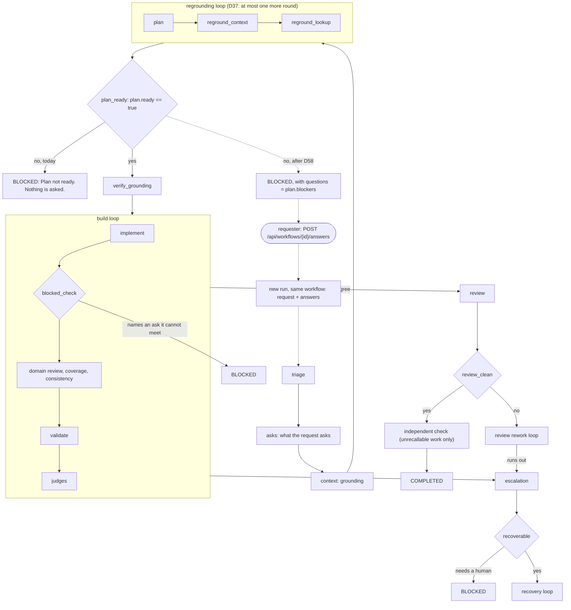

# D58: a plan that is not ready asks the requester (advisor, 2026-10-29)

**Status: drafted by the advisor on 2026-10-29, on the owner's direction under D37.** Command ARCH-20261029-130 will carry it. Its task file is not written yet. It is free work: no paid call, no `.env` change, and no DB schema change.

**The owner's direction (2026-10-29), under D37:** the plan gate stays, and "it should ask for human input and/or clarification for anything deemed not ready".

## 1. What is wrong today

- A plan that is not ready ends the run as `blocked`, with the reason "Plan not ready: <blockers>". In `full-team`, D37 first allows one more grounding round; in `lean`, the run stops at once.
- The run asks the requester nothing in a typed form. The blockers exist only inside the reason string and the plan's own phase record.
- The requester has no way to answer and go on. They must write a new request by hand.
- When a gate closes, the executor records only `{"passed": false}` (`_decide_gate` in `autornd/graph/executor.py`). Nothing typed says that the run needs answers from the requester.

## 2. The ruling (draft)

> **(1) A gate can name what it asks the requester.** A gate node may carry `asks_requester: <dotted.path>`. The path resolves the way a condition's path does, and a missing path raises. When that gate ends the run, the executor sets `state.questions` to that list, with empty entries dropped. It is a record field, like `state.candidate`, never a status. Only a gate may carry the key, and the spec refuses it anywhere else.
>
> **(2) The plan gate asks.** `plan_ready` in `workflows/full-team.yaml` and `workflows/lean.yaml` gains `asks_requester: plan.blockers`. The status stays `blocked` and the reason stays as it is.
>
> **(3) The caller sees the questions.** The API path records them as a zero-cost phase record, `questions`, holding `{"gate": <node id>, "questions": [...]}`, the way D57's `candidate` record is written. `GET /api/workflows/{id}` returns `questions`: the list, or `null` when the run asked nothing.
>
> **(4) The requester answers.** `POST /api/workflows/{id}/answers` takes `{"answers": ["...", ...]}`, one answer per question, in order. It starts a new run of the same workflow, named by the parent's `workflow` record (D55). The new run is admitted exactly as `POST /api/workflows` admits a run. Its request is the parent's request followed by:
>
>     Answers from the requester:
>     1. Q: <question 1>
>        A: <answer 1>
>
> The new run records a zero-cost phase record, `answers`, holding `{"answers_for": <parent id>, "questions": [...], "answers": [...]}`. The reply is 202 with the new run's summary. Refusals, each a plain sentence:
> - another caller's run, or a missing one: 404;
> - a run that asked no questions: 409;
> - a wrong number of answers, or an empty one: 422.
>
> **(5) Nothing else changes.** The eval runner and the CLI have no requester to ask. They see `blocked` as they do today, and the record carries the questions.

**Why a new run and not a resume:** a new run needs no saved executor state and no schema change, and it is checked from the top like any other run. The answers become part of the request, so the judges can quote them as anchors (D51 (3)).

## 3. Where each change goes

| file | change |
|---|---|
| `autornd/graph/spec.py` | `Node.asks_requester: str \| None`, read where `on_fail_reason` is read; refused on any kind but `gate` |
| `autornd/graph/executor.py` | `ExecutionState.questions: list[str] \| None = None`; set in `_decide_gate` when a gate with `asks_requester` ends the run |
| `autornd/engine/workflow.py` | after `executor.run`, beside the `candidate` record: write the `questions` record when `state.questions` is set |
| `autornd/api/routes.py` | `WorkflowDetail.questions`; `_detail` reads the last `questions` record; new route `POST /workflows/{workflow_id}/answers`, through `_requested_workflow`, `_admit_run` and `_run_workflow_bg` as `submit_workflow` uses them |
| `workflows/full-team.yaml`, `workflows/lean.yaml` | one line on `plan_ready`: `asks_requester: plan.blockers` |
| `tests/test_plan_asks.py` | new; see §4 |
| `README.md`, `HANDOVER.md`, `AGENTS.md` | the API paragraph, and the counts re-derived from collection |

## 4. What proves it, provider-free

- A not-ready plan's run ends `blocked`, and `GET` returns its blockers as `questions`, in `full-team` and in `lean`.
- A ready plan's run has no `questions`.
- Answering starts a new run of the same workflow. Its request carries each question and answer, its plan prompt contains the answers, and its `answers` record names the parent.
- The refusals: 404, 409 and 422, each leaving no row and holding no admission slot.
- The spec refuses `asks_requester` on a node that is not a gate. A missing path raises.
- A sync guard: every workflow with a `plan_ready` gate declares `asks_requester`.

Each test gets a break-proof in the command's task file.

## 5. Not ruled here

| left out | why |
|---|---|
| The implementer's block (`blocked_terminal`: an ask it cannot meet) and "Escalation requires human intervention" | Both also end a run that a requester could unblock. Each would take one YAML line with this mechanism. The owner named the plan; the others are the owner's call. |
| Resuming the same run | Needs saved executor state. A new run is simpler and checked from the top. |
| Telling the plan prompt to write its blockers as questions | Prompt text that steers judgment needs its own ruling. |
| Showing the questions on the dashboard | Not needed for the API caller. |

## 6. Budgets (convention 18)

No call is added. Answering starts a new run, which is admitted and bounded like every other run.

## 7. The workflow, and where D58 lands

`full-team`, simplified (the YAML file is the source). The dashed path is what D58 adds.

